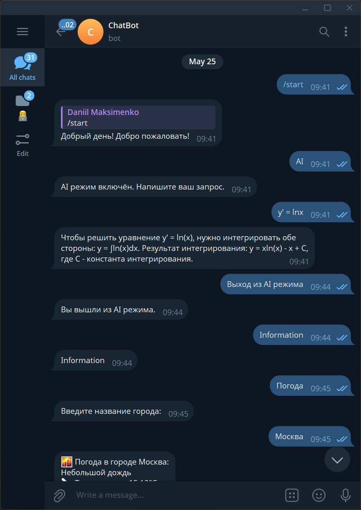
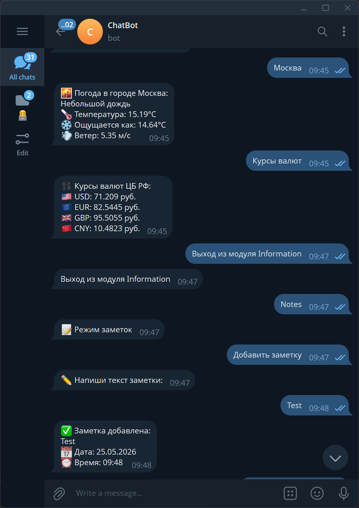

# ChatBot
**ChatBot** — Telegram-бот, разработанный на **Python** с использованием фреймворка **aiogram**. Бот объединяет несколько полезных сервисов в одном интерфейсе: работу с искусственным интеллектом, получение курса валют, просмотр текущей погоды и управление заметками.

## Возможности
* 🤖 Общение с AI через ProxyAPI
* 🌤 Получение текущей погоды
* 💱 Просмотр актуальных курсов валют Центрального банка России
* 📝 Создание и хранение заметок
* ⌨️ Удобное управление с помощью Telegram-клавиатур

## Используемые технологии
* Python 3
* aiogram
* ProxyAPI
* OpenWeather API
* API Центрального банка РФ

## Структура проекта
```text
ChatBot/
├── main.py
├── ai.py
├── info.py
├── notes.py
├── core/
│   └── config.py
├── keyboards/
│   ├── ai_keyboard.py
│   ├── info_keyboard.py
│   ├── main_keyboard.py
│   └── note_keyboard.py
└── services/
    ├── ai_service.py
    ├── cb_service.py
    └── weather_service.py
```

## Используемые API
* **AI:** ProxyAPI
* **Погода:** OpenWeather API
* **Курсы валют:** API Центрального банка РФ

## Установка
Клонируйте репозиторий:
```bash
git clone https://github.com/DaniilMaksimenko2001/chat_bot.git
cd chat_bot
```

Настройте файл конфигурации (`core/config.py`) или переменные окружения, указав:
* Telegram Bot Token
* ProxyAPI Key
* OpenWeather API Key

После этого запустите бота:
```bash
python main.py
```

## Скриншоты



## Основные команды
* 🤖 Общение с AI
* 🌤 Получение информации о погоде
* 💱 Просмотр курса валют
* 📝 Работа с заметками

## Используемые API
| Сервис          | Назначение                        |
| --------------- | --------------------------------- |
| ProxyAPI        | Генерация ответов AI              |
| OpenWeather API | Получение информации о погоде     |
| API ЦБ РФ       | Получение актуальных курсов валют |

## Планы по развитию
* История диалогов с AI
* Голосовые сообщения
* Напоминания
* Хранение заметок в базе данных
* Поддержка нескольких языков
* Docker-контейнеризация

## Лицензия
Проект создан в образовательных целях.
